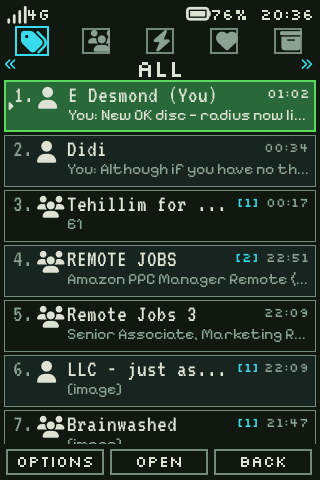

# Dumbphone — an open, honest phone for the modern age

A purpose-built, low-cost dumbphone: an ESP32-S3 driving a 320×480 panel, a classic T9
keypad, and a server-side brain. Not a full window onto the world — a small lens, focused
on what you actually want coming in, out, and around you.

Read the pitch: [`docs/manifesto.md`](docs/manifesto.md).



## What's here

This repository is the **UI firmware and its Linux desktop simulator**.

| Path | What it is |
|---|---|
| `firmware/` | The firmware. Plain C11. LVGL 9.4 + ESP-IDF v5.5 for the device, SDL2 for the desktop simulator. |
| `firmware/ui/` | The phone UI — target-agnostic LVGL code. One renderer (`menu_t`), one theme/token layer, per-page keymaps. |
| `firmware/hal/` | The hardware abstraction layer: display, input, net, storage, audio. Headers only — backends per target. |
| `firmware/host/` | Desktop target only: SDL window, the physical-button bezel, a browser viewport server, JSON chat fixtures. |
| `docs/` | Architecture (UI + firmware), the design manifesto, harness setup, and a code audit report. |
| `screenshots/` | Golden frames captured from the simulator — one per screen. |
| `concept-art/` | Early visual concepts that set the aesthetic. |

## Design principles

- **Stable frame.** Status bar top, action bar bottom; only the content area swaps. The phone never jerks around.
- **One renderer.** Every page is a `menu_t` — list or grid, same code path.
- **Physical-first, touch-capable.** The T9 keypad and d-pad are the primary input; the panel is capacitive for those who reach for it.
- **Server-driven terminal.** The device renders and handles input; heavy lifting (messaging bridges, maps, sync) lives on a server. No app store.
- **Flat pixels.** Charcoal, one green, one cyan. No gradients, no shadows, cheap to render.
- **No allocations in the hot path.** Static draw buffers, static screen stack, static rows.

## Build it

**Desktop simulator** (Linux; needs SDL2 and `just`):

```sh
cd firmware
just vendor          # fetch pinned LVGL v9.4.0
just build-desktop
just run-desktop     # SDL window with the physical bezel
just shot-desktop chat   # headless golden frame -> screenshots/
```

The simulator also serves a **browser viewport** (`just run-desktop` prints the URL) so the
same UI can be driven from a tablet or phone on the LAN.

**Device** (ESP-IDF v5.5+, target `esp32s3`):

```sh
cd firmware
just build-s3
just flash-s3
```

## Hardware

Current dev board: **Waveshare ESP32-S3-Touch-LCD-3.5** (N16R8) — 3.5″ IPS 320×480,
5-point capacitive touch, plus camera and microphone. A smaller phone-sized panel is
planned for the final form factor.

## Status

The UI shell is feature-complete as a simulator: home chat list, main-menu carousel and
grid, Calls (history + contacts), Settings tree with working toggles, speed dials,
held-press key config, options sidebar, swipe navigation, and a lock screen. The messaging
backbone (a WhatsApp bridge over Wi-Fi) and the S3 HAL backends are next.

Design docs: [`docs/ui-architecture.md`](docs/ui-architecture.md) ·
[`docs/firmware-architecture.md`](docs/firmware-architecture.md) ·
[`docs/ROADMAP.md`](docs/ROADMAP.md)

## Licence

Mozilla Public License 2.0 — see [`LICENSE`](LICENSE). You may build on this, including commercially,
and combine it with code under other licences; if you modify the project's own files, those
modifications must be published under the same terms.

Contributions welcome — read [`CONTRIBUTING.md`](CONTRIBUTING.md) first. Commits need a
`Signed-off-by` line (`git commit -s`).
